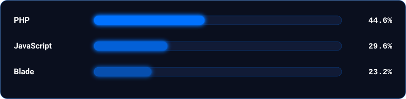

 

 

-  Web Developer yang fokus pada ekosistem **Laravel + Filament**
-  Suka membuat tampilan modern dan bersih dengan **Tailwind CSS**
-  Paham dasar **SEO dan analitik** (Google Search Console, Google Analytics)
-  Sedang belajar **Blade, VPS, dan Express.js**
-  Selalu tertarik mencoba teknologi baru dan membangun proyek nyata

 

 

 

 

 

 

 

<!-- Hapus tanda komentar dan isi dengan akun kamu

-->

